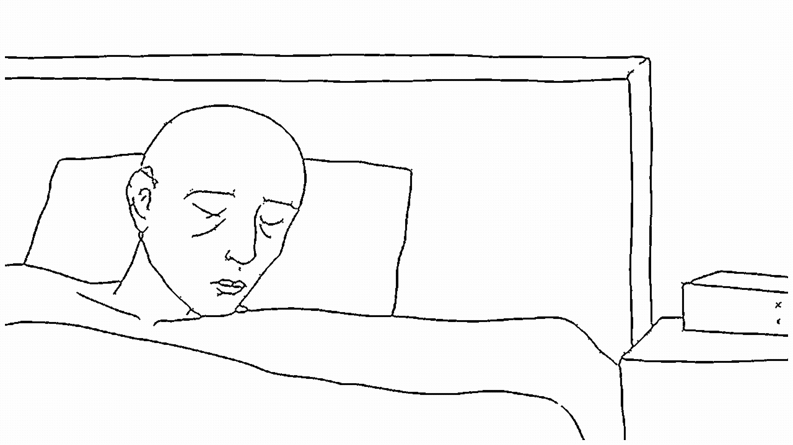

# TP2: Production d'animation

## Description
- L'animation dure 20 secondes.
- La fréquence est de 12 images par secondes.
- 4 principes d'animation ont été utilisés.
- 1) Anticipation :
     - scène 1: le personnage prépare son mouvement avant d'étendre son bras pour éteindre son alarme.
     - scène 7: il baisse légèrement les épaules et prépare son corps avant de tomber dans son lit.
- 2) Écrasement et étirement : 
     - scène 7: son corps s'étire un peu pendant qu'il tombe sur le lit, l'oreiller et la couverture aussi.
- 3) Exagération :
     - scène 2: le mouvement de la brosse à dent et du bras sont amplifiés.
     - scène 4: les doigts frappent le clavier de manière exagérée.
- 4) Retards et chevauchements :
     - scènes 5 et 5: la fumée continue de bouger après les mouvements du personnage.
     - scène 6: le manteau continue à bouger après avoir été accroché.

## Inspiration
- J'avais en tête le thème d'un <<blues>>. Je voulais animer un personnage qui vivait une vie en boucle, de travail et de mélancolie.
- J'ai choisi de garder les couleurs en noir et blanc pour illustrer encore plus le sentiment vécu.
- J'ai aussi choisi d'ajouter des éléments comme la cigarette et l'hiver, avec des enfants qui jouent dehors qu'il ne remarque pas, pour accentuer cette atmosphère.
- Le thème est inspiré d'une personne que je connais personnellement, ce qui m'a vraiment motivée à travailler dessus.

## Commentaires
- J'aurais voulu que les détails comme les yeux, etc. soient mieux travaillés.
- J'ai dessiné le personnage dans une genre de grille avec des scènes, d'abord sur papier puis sur mon ordinateur (j'ai eu un peu de difficulté à cacher les cases dans certaines scènes).
- Je me suis beaucoup améliorée à dessiner avec la souris, surtout en apprenant à ajuster ma souris et à me déplacer sur mon écran (zoomer, etc).
- J'ai beaucoup aimé utiliser les masques de transformation, je les ai trouvés très pratiques comparés à l'image par image.
- J'ai eu de la difficulté à faire l'animation image par image, parce qu'il y avait des éléments dans mon animation que je ne pouvais pas redessiner parfaitement et je n'arrivais pas à copier coller à mon goût.
